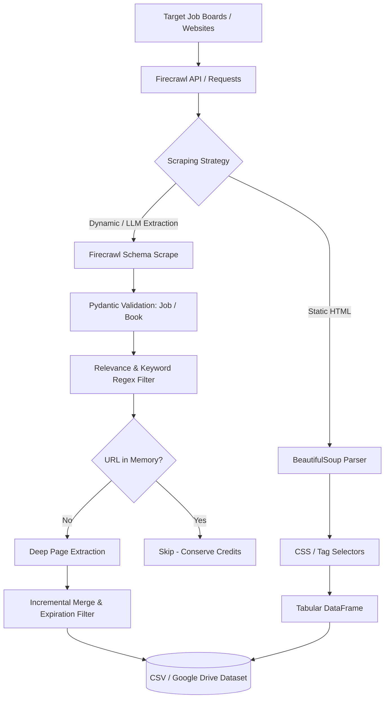

# 🌐 Web Scraping & Intelligent Data Extraction Masterclass

A complete, practical learning repository and production-ready toolkit for **Web Scraping in Python** — taking you from fundamental HTML parsing with **Requests & BeautifulSoup** to modern AI-driven structured data extraction with **Firecrawl**, culminating in an automated **Multi-Board AI & Data Job Harvesting Pipeline**.

---

## 📑 Table of Contents

- [Overview](#-overview)
- [Repository Structure](#-repository-structure)
- [Curriculum & Notebook Breakdown](#-curriculum--notebook-breakdown)
  - [1. Web Scraping for Beginners](#1-web-scraping-for-beginners)
  - [2. Firecrawl for AI-Powered Web Scraping](#2-firecrawl-for-ai-powered-web-scraping)
  - [3. Automated Multi-Board Job Scraper Pipeline](#3-automated-multi-board-job-scraper-pipeline)
  - [4. Handwritten Study Notes](#4-handwritten-study-notes)
- [Scraping Pipeline Architecture](#-scraping-pipeline-architecture)
- [Prerequisites & Installation](#-prerequisites--installation)
- [How to Run](#-how-to-run)
- [Target Job Boards & Data Schema](#-target-job-boards--data-schema)
- [Best Practices & Ethical Scraping](#-best-practices--ethical-scraping)
- [License & Acknowledgments](#-license--acknowledgments)

---

## 📖 Overview

Modern web scraping spans two paradigms:
1. **Classical Parsing**: Interrogating static DOM hierarchies using HTTP requests and CSS/tag selectors (`requests` + `BeautifulSoup`).
2. **AI-Assisted & Headless Crawling**: Handling dynamic JavaScript, anti-bot defenses, full-domain crawling, and LLM-powered schema extraction (`firecrawl-py` + `pydantic`).

This repository provides hands-on notebooks, structured data pipelines, and scanned reference notes covering both worlds with production techniques such as URL deduplication, incremental scraping memory, regex relevancy filtering, and date-based expiration.

---

## 📂 Repository Structure

```plaintext
Web scraping/
├── Web_Scraping_for_Beginner.ipynb      # Foundation: Requests, BeautifulSoup4, CSV export
├── Firecrawl_for_web_scraping.ipynb     # Next-Gen: Scrape, Crawl, and Map with Firecrawl API
├── Find_jobs_from_website.ipynb         # Project: Automated multi-board AI/ML/Data job harvester
├── requirements.txt                     # Python package dependencies
├── Handwitten Note for web scraping/    # Scanned comprehensive notes on scraping fundamentals
│   └── CamScanner 10-15-2026 13.29.pdf
├── Handwritten Note for Firecrawl/      # Scanned visual notes on Firecrawl operations
│   └── CamScanner 10-15-2026 13.36.pdf
└── README.md                            # Repository documentation & guide
```

---

## 🎓 Curriculum & Notebook Breakdown

### 1. Web Scraping for Beginners
**Notebook**: [`Web_Scraping_for_Beginner.ipynb`](./Web_Scraping_for_Beginner.ipynb)  
**Focus**: Foundational HTML inspection and static web scraping.

- **Target Sandbox**: [Books to Scrape](https://books.toscrape.com/)
- **Core Concepts**:
  - Understanding client-server communication: HTTP requests, response status codes (`200 OK`, `404 Not Found`).
  - Using browser Developer Tools (Inspect Element) to map HTML tags, classes, and attributes.
  - Parsing HTML with `BeautifulSoup`:
    - `find()` for singular elements vs. `find_all()` for collections.
    - Handling missing elements (`NoneType` safety).
  - Extracting product titles, prices, and stock availability.
  - Structuring records into a `pandas.DataFrame` and exporting to `books.csv` and Excel.

---

### 2. Firecrawl for AI-Powered Web Scraping
**Notebook**: [`Firecrawl_for_web_scraping.ipynb`](./Firecrawl_for_web_scraping.ipynb)  
**Focus**: Modern, LLM-powered scraping and full-site exploration without brittle selectors.

- **Core Primitives Covered**:
  - `app.scrape()`: Extracting clean markdown or forcing strictly typed JSON using `pydantic.BaseModel` schemas.
  - `app.crawl()`: Deep-crawling multiple paginated pages, handling dynamic content, combining multi-page results into a single dataset, and converting string prices to numeric floats.
  - `app.map()`: Fast sitemapping to discover all indexed links across a target domain and segmenting them into product pages, category pages, and utility routes.
- **Visualization**: Exploratory data analysis (EDA) and price distribution histograms using `matplotlib.pyplot`.

---

### 3. Automated Multi-Board Job Scraper Pipeline
**Notebook**: [`Find_jobs_from_website.ipynb`](./Find_jobs_from_website.ipynb)  
**Focus**: Production-grade job extraction pipeline targeting AI, Machine Learning, and Data Science vacancies.

- **Architecture Highlights**:
  - **Stage 1 (Listing Extraction)**: Uses Firecrawl with structured extraction (`JobLinkList`) to harvest all active listing URLs from targeted job portals.
  - **Stage 2 (Relevance Filter)**: Applies keyword tokenization and word-boundary regular expressions (`PATTERNS`, `SHORT_WORDS`) to filter listings for Data Scientists, ML Engineers, AI Researchers, NLP, and Computer Vision specialists.
  - **Stage 3 (Deep Extraction)**: Visited pages are extracted using a strictly typed `Job` schema:
    - Exact job title and company name.
    - Authentic original posted date (`YYYY-MM-DD`), preventing false updates or deadline confusion.
    - Location, work arrangement (Remote / Onsite), salary range, and required technical skills.
  - **Stage 4 (Deduplication & Incremental Memory)**: Reads previous extractions (`load_known_urls`) from local storage or Google Drive to skip already scraped postings and conserve API credits.
  - **Stage 5 (Data Lifecycle Management)**: Automatically cleans expired jobs (e.g., postings older than 7 days) and exports clean, standardized datasets.

---

### 4. Handwritten Study Notes
In-depth reference notes scanned from study sessions:
- [Handwitten Note for web scraping](<./Handwitten Note for web scraping/CamScanner 10-15-2026 13.29.pdf>): Detailed notes on DOM trees, HTTP methods, BeautifulSoup syntax, and parsing logic.
- [Handwritten Note for Firecrawl](<./Handwritten Note for Firecrawl/CamScanner 10-15-2026 13.36.pdf>): Visual maps of Firecrawl's architecture, API parameters, and workflow.

---

## 🔄 Scraping Pipeline Architecture



---

## 🛠️ Prerequisites & Installation

### Environment Setup
Python 3.10 or newer is recommended.

1. **Clone the repository:**
   ```bash
   git clone <repo-url>
   cd "Web scraping"
   ```

2. **Create and activate a virtual environment:**
   ```bash
   # Windows (PowerShell)
   python -m venv venv
   .\venv\Scripts\Activate.ps1

   # Linux / macOS
   python3 -m venv venv
   source venv/bin/activate
   ```

3. **Install dependencies:**
   ```bash
   pip install requests beautifulsoup4 pandas openpyxl firecrawl-py pydantic matplotlib
   ```

---

## 🚀 How to Run

### 1. Running Locally via Jupyter Lab or VS Code
Launch Jupyter Lab:
```bash
jupyter lab
```
Open any of the `.ipynb` notebooks and execute cells sequentially.

### 2. Setting Up Firecrawl API Key
For notebooks utilizing Firecrawl (`Firecrawl_for_web_scraping.ipynb` and `Find_jobs_from_website.ipynb`), obtain an API key from [Firecrawl.dev](https://firecrawl.dev).

You can enter the key interactively via `input()` when prompted in the notebook, or set it as an environment variable:
```bash
# Windows PowerShell
$env:FIRECRAWL_API_KEY="fc-YOUR_API_KEY_HERE"

# Linux / macOS
export FIRECRAWL_API_KEY="fc-YOUR_API_KEY_HERE"
```

### 3. Running in Google Colab
Both Firecrawl notebooks are Colab-ready:
- `Find_jobs_from_website.ipynb` includes pre-configured Google Drive mounting (`from google.colab import drive`) to automatically save datasets to `/content/drive/MyDrive/jobdatacsv`.

---

## 🎯 Target Job Boards & Data Schema

The automated job harvester monitors regional (Nepal), global remote, and specialized tech company boards:

| Portal | Scope | Region |
|---|---|---|
| **Merojob** | IT & Telecommunications | Nepal |
| **Kumarijob** | Data & Tech Searches | Nepal |
| **JobsNepal** | IT & Computer | Nepal |
| **RemoteOK** | Remote Data Science | Global |
| **WeWorkRemotely** | Remote Data Jobs | Global |
| **Himalayas** | Data Science & AI | Global |
| **Remote.co** | Data & Analytics | Global |
| **Working Nomads** | Data Positions | Global |
| **Hugging Face** | AI / ML Research & Engineering | Remote / Global |

### Harvested Data Fields

| Field | Type | Description |
|---|---|---|
| `title` | `str` | Exact job title |
| `company` | `str` | Hiring organization |
| `posted_date` | `str` | Original posting date (`YYYY-MM-DD`) |
| `skills` | `list[str]` | Detected tech stack & libraries |
| `salary` | `str` | Compensation range (if disclosed) |
| `country` | `str` | Geographical restriction or "Anywhere" |
| `work_type` | `str` | `Remote`, `Onsite`, or `Hybrid` |
| `apply_url` | `str` | Direct link to application portal |
| `source` | `str` | Name of the source board |
| `url` | `str` | Canonical URL of the vacancy page |

---

## ⚖️ Best Practices & Ethical Scraping

- **Robots.txt & Rate Limiting**: Always inspect the target website's `robots.txt` before deploying automated scrapers. Add reasonable delays between requests to avoid overwhelming target servers.
- **Deduplication**: Use memory layers (such as the `load_known_urls` logic in this repo) to prevent redundant calls and minimize bandwidth consumption.
- **Terms of Service**: Comply with terms of service and acceptable use policies of any platforms being accessed.
- **API Over Headless**: When available, leverage official APIs or modern AI crawlers designed for structured rate-limited extraction.

---

## 📄 License & Acknowledgments

- Practice sandbox provided by [Books to Scrape](https://books.toscrape.com/).
- AI crawling powered by [Firecrawl](https://firecrawl.dev).
- Developed for educational and data extraction research purposes.
